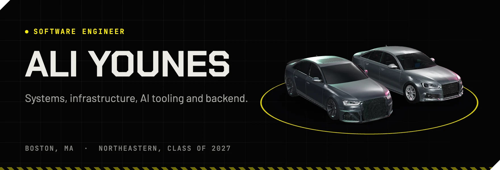
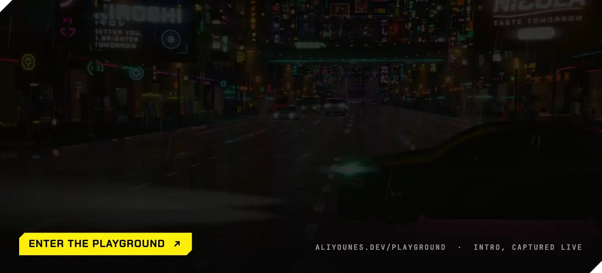
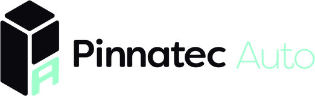

  <a href="https://aliyounes.dev"><b>aliyounes.dev</b></a> &nbsp;·&nbsp;
  <a href="https://aliyounes.dev/blog/">Writing</a> &nbsp;·&nbsp;
  <a href="https://aliyounes.dev/resume.pdf">Resume</a> &nbsp;·&nbsp;
  <a href="https://sideband.studio">Sideband Studio</a> &nbsp;·&nbsp;
  <a href="https://x.com/whoisaldooo">X</a> &nbsp;·&nbsp;
  <a href="https://www.linkedin.com/in/alialdoyounes/">LinkedIn</a> &nbsp;·&nbsp;
  <a href="mailto:aldo@sideband.studio">aldo@sideband.studio</a>

Hi! I'm Ali, or you can call me Aldo. I'm a fourth year studying computer science and political science at Northeastern University in Boston, MA 📍.

I like to work with deeply architected systems. Most of my work tends to revolve around automating, but I usually just kinda build a solution to anything really 🤷‍♂️. The work I did at Philips and AWS is what I've enjoyed the most so far.

I have a 2013 Audi S4 that makes around 540 whp. It's on a Jackal Stage 2+ tune and I love to work on it myself :p. I also have a 2013 Audi S6 with the 4.0 twin-turbo V8, on a Stage 1 Integrated Engineering tune. It runs Virtual Link, the lowering module I'm lead engineer on at Pinnatec.

Check out my portfolio, it's pretty cool, especially if you're a cyberpunk fan 👇

### History
<table>
<tr><td align="center"><picture><source media="(prefers-color-scheme: dark)" srcset="./logos/aws-dark.png"></picture></td><td><a href="https://github.com/aws"><b>Amazon Web Services</b></a></td><td>SDE, Amazon Dedicated Cloud</td><td>Incoming FTE July 2027</td></tr>
<tr><td align="center"></td><td><a href="https://github.com/philips-software"><b>Philips</b></a></td><td>SDE Co-op, back part-time</td><td>Aug 2026 to now</td></tr>
<tr><td align="center"><picture><source media="(prefers-color-scheme: dark)" srcset="./logos/pinnatec-dark.png"></picture></td><td><a href="https://pinnatecauto.com/"><b>Pinnatec Auto</b></a></td><td>Lead Full Stack Engineer, Virtual Link</td><td>Sep 2026 to now</td></tr>
<tr><td align="center"></td><td><a href="https://github.com/pawtograder"><b>Pawtograder</b></a></td><td>Backend Engineer, grading server</td><td>Aug 2026 to now</td></tr>
<tr><td align="center"><picture><source media="(prefers-color-scheme: dark)" srcset="./logos/aws-dark.png"></picture></td><td><a href="https://github.com/aws"><b>Amazon Web Services</b></a></td><td>SDE Intern, CloudFormation Registry</td><td>Jun to Sep 2026</td></tr>
<tr><td align="center"></td><td><a href="https://github.com/philips-software"><b>Philips</b></a></td><td>SDE Co-op, System Integration</td><td>Jan to Jun 2026</td></tr>
<tr><td align="center"></td><td><a href="https://topchoicerealtyny.com/"><b>Top Choice Realty</b></a></td><td>Frontend Developer Intern</td><td>Apr to Aug 2024</td></tr>
<tr><td align="center"></td><td><a href="https://github.com/northeastern"><b>Northeastern University</b></a></td><td>CS and Political Science, B.S.</td><td>Class of 2027</td></tr>
</table>

